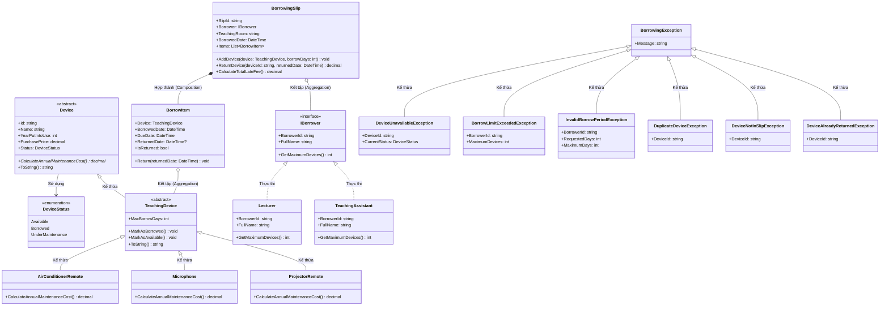
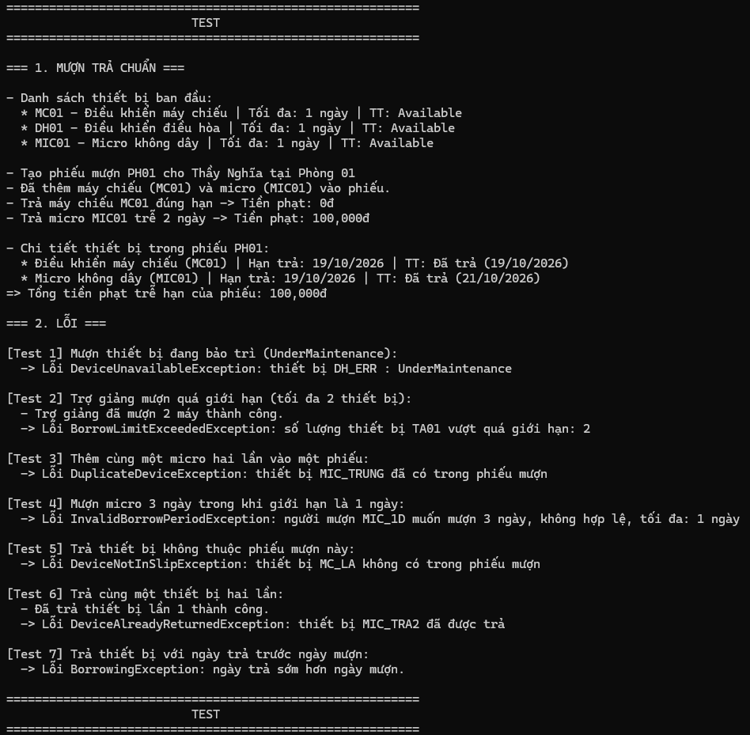

# Bài 6

Mã sinh viên: 202418989
Họ tên: Chu Đình Thi

## Link phiên làm việc AI
https://share.gemini.google/0KByAM9PCE0X

## Phân tích và thiết kế

### A. Mô tả các class

#### 1. Class Device (Abstract)

- Trách nhiệm: Lưu trữ thông tin cơ bản của thiết bị trong hệ thống, làm khung cho các lớp thiết bị kế thừa.
- Thuộc tính: `Id`, `Name`, `YearPutIntoUse`, `PurchasePrice`, `Status`.
- Constructor: Hàm tạo nhận 4 tham số để gán thông tin ban đầu, bắt lỗi nếu mã rỗng, giá mua <= 0 hoặc năm sử dụng lớn hơn năm hiện tại.
- Phương thức: `CalculateAnnualMaintenanceCost()` (abstract), `ToString()`.
- Quan hệ: Lớp cha trực tiếp của `TeachingDevice`.

#### 2. Class TeachingDevice (Abstract)

- Trách nhiệm: Quản lý thông tin thiết bị phục vụ giảng dạy, bổ sung giới hạn số ngày mượn và cập nhật trạng thái mượn/trả.
- Thuộc tính: `MaxBorrowDays` (kế thừa các thuộc tính từ `Device`).
- Constructor: Gọi base constructor của `Device` và thiết lập `MaxBorrowDays`.
- Phương thức: `MarkAsBorrowed()`, `MarkAsAvailable()`, `ToString()`.
- Quan hệ: Kế thừa từ `Device`, làm lớp cha cho `AirConditionerRemote`, `Microphone`, `ProjectorRemote`.

#### 3. Class AirConditionerRemote

- Trách nhiệm: Quản lý thiết bị điều khiển điều hòa tại các phòng học, tính chi phí bảo trì định kỳ.
- Thuộc tính: Kế thừa từ `TeachingDevice`.
- Constructor: Nhận mã, tên, năm, giá và `maxDays` mặc định là 1 ngày.
- Phương thức: Override `CalculateAnnualMaintenanceCost()` (bằng 10% giá mua).
- Quan hệ: Kế thừa từ `TeachingDevice`.

#### 4. Class Microphone

- Trách nhiệm: Quản lý thiết bị micro không dây giảng dạy, tính chi phí bảo trì định kỳ.
- Thuộc tính: Kế thừa từ `TeachingDevice`.
- Constructor: Nhận mã, tên, năm, giá và `maxDays` mặc định là 1 ngày.
- Phương thức: Override `CalculateAnnualMaintenanceCost()` (bằng 15% giá mua).
- Quan hệ: Kế thừa từ `TeachingDevice`.

#### 5. Class ProjectorRemote

- Trách nhiệm: Quản lý điều khiển máy chiếu trong phòng dạy, tính chi phí bảo trì định kỳ.
- Thuộc tính: Kế thừa từ `TeachingDevice`.
- Constructor: Nhận mã, tên, năm, giá và `maxDays` mặc định là 1 ngày.
- Phương thức: Override `CalculateAnnualMaintenanceCost()` (bằng 8% giá mua).
- Quan hệ: Kế thừa từ `TeachingDevice`.

#### 6. Interface IBorrower

- Trách nhiệm: Quy định giao ước chung cho đối tượng mượn thiết bị và hạn mức mượn tối đa.
- Thuộc tính: `BorrowerId`, `FullName`.
- Phương thức: `GetMaximumDevices()`.

#### 7. Class Lecturer

- Trách nhiệm: Quản lý thông tin đối tượng giảng viên mượn thiết bị.
- Thuộc tính: `BorrowerId`, `FullName`.
- Constructor: Nhận mã giảng viên và họ tên.
- Phương thức: Thực thi `GetMaximumDevices()` (trả về tối đa 3 thiết bị/phiếu).
- Quan hệ: Thực thi interface `IBorrower`.

#### 8. Class TeachingAssistant

- Trách nhiệm: Quản lý thông tin đối tượng trợ giảng mượn thiết bị.
- Thuộc tính: `BorrowerId`, `FullName`.
- Constructor: Nhận mã trợ giảng và họ tên.
- Phương thức: Thực thi `GetMaximumDevices()` (trả về tối đa 2 thiết bị/phiếu).
- Quan hệ: Thực thi interface `IBorrower`.

#### 9. Class BorrowItem

- Trách nhiệm: Đại diện cho 1 mục thiết bị đc mượn trong phiếu, ghi nhận ngày mượn, hạn trả và ngày trả thực tế.
- Thuộc tính: `Device`, `BorrowedDate`, `DueDate`, `ReturnedDate`, `IsReturned`.
- Constructor: Khởi tạo mục mượn vs thiết bị, ngày mượn, hạn trả; `ReturnedDate` ban đầu mặc định là null.
- Phương thức: `Return(DateTime returnedDate)`.
- Quan hệ: Kết tập (Aggregation) vs `TeachingDevice` (chỉ tham chiếu, ko sở hữu vòng đời của máy).

#### 10. Class BorrowingSlip

- Trách nhiệm: Quản lý thông tin phiếu mượn, kiểm soát nghiệp vụ thêm/trả thiết bị và tính tiền phạt trễ hạn.
- Thuộc tính: `SlipId`, `Borrower`, `TeachingRoom`, `BorrowedDate`, `Items` (danh sách `BorrowItem`).
- Constructor: Khởi tạo phiếu vs mã phiếu, người mượn, phòng dạy và danh sách mục mượn rỗng.
- Phương thức: `AddDevice()`, `ReturnDevice()`, `CalculateTotalLateFee()`.
- Quan hệ: Hợp thành (Composition) vs `BorrowItem` (quản lý trực tiếp ds các mục mượn); Kết tập (Aggregation) vs `IBorrower`.

#### 11. Hệ phân cấp ngoại lệ (BorrowingExceptions)

- `BorrowingException`: Ngoại lệ gốc kế thừa từ `Exception`, dùng làm cha cho các ngoại lệ nghiệp vụ mượn trả.
- `DeviceUnavailableException`: Phát sinh khi thiết bị ko ở trạng thái `Available` (đang đc mượn hoặc bảo trì).
- `BorrowLimitExceededException`: Phát sinh khi người mượn đã đạt hoặc vượt quá số lượng thiết bị cho phép.
- `InvalidBorrowPeriodException`: Phát sinh khi số ngày mượn <= 0 hoặc vượt quá số ngày mượn tối đa của thiết bị.
- `DuplicateDeviceException`: Phát sinh khi thêm cùng 1 thiết bị hai lần vào cùng 1 phiếu.
- `DeviceNotInSlipException`: Phát sinh khi yêu cầu trả 1 thiết bị ko có trong phiếu mượn.
- `DeviceAlreadyReturnedException`: Phát sinh khi cố gắng trả lại 1 thiết bị đã đc trả trước đó.

### B. Các bất biến của mô hình

- Mã thiết bị (`Id`) ko đc để trống, chỉ đc gán 1 lần duy nhất khi tạo và ko đc sửa lại.
- Giá mua (`PurchasePrice`) bắt buộc phải lớn hơn 0.
- Năm đưa vào sử dụng (`YearPutIntoUse`) ko đc lớn hơn năm hiện tại.
- Hạn mượn tối đa của thiết bị (`MaxBorrowDays`) phải lớn hơn 0.
- Giới hạn mượn của Giảng viên là 3 thiết bị, Trợ giảng là 2 thiết bị trên 1 phiếu.
- Số ngày mượn phải lớn hơn 0 và ko đc vượt quá số ngày mượn tối đa của thiết bị đó.
- Không cho phép mượn thiết bị nếu trạng thái ko phải là `Available`.
- Trong cùng 1 phiếu mượn, ko đc phép thêm trùng lặp 1 thiết bị hai lần.
- Hạn trả (`DueDate`) phải sau hoặc bằng ngày mượn (`BorrowedDate`).
- Ngày trả thực tế (`ReturnedDate`) ko đc trước ngày mượn (`BorrowedDate`).
- Mỗi thiết bị trong phiếu chỉ đc trả 1 lần duy nhất, ko cho phép trả hai lần.
- Đảm bảo tính nhất quán (Transactional consistency): Nếu thao tác mượn gặp lỗi thì ko đc thay đổi trạng thái của máy thành `Borrowed` và ko thêm mục dở dang vào danh sách.

### C. Giải thích thiết kế nâng cao

- **Vì sao tự tạo hệ phân cấp ngoại lệ riêng (BorrowingException) thay vì dùng Exception chung?**
  - Tách bạch rõ ràng giữa lỗi nghiệp vụ mượn trả vs các lỗi kỹ thuật hoặc lỗi hệ thống (như `NullReferenceException`, `IndexOutOfRangeException`...).
  - Giúp tầng xử lý giao diện/kiểm thử có thể bắt (`catch`) chính xác từng lỗi cụ thể để xuất thông báo rõ ràng cho người dùng, thay vì dùng `catch (Exception)` chung chung làm ẩn giấu lỗi.
  - Cho phép đóng gói đầy đủ các dữ liệu ngữ cảnh nghiệp vụ (như `DeviceId`, `BorrowerId`, `CurrentStatus`, `MaximumDays`...) ngay trong thuộc tính của exception để dễ dàng debug và tra soát lỗi.
  - Dễ bảo trì và mở rộng thêm các ngoại lệ nghiệp vụ mới trong tương lai mà ko làm xáo trộn cấu trúc code hiện có.

- **Đảm bảo tính nhất quán trạng thái (Transactional consistency) trong AddDevice như thế nào?**
  - Áp dụng kỹ thuật kiểm tra hợp lệ toàn bộ (Validate First) trước khi thực hiện bất kỳ hành động ghi nhận dữ liệu nào.
  - Cụ thể trong `AddDevice()`, hệ thống sẽ lần lượt kiểm tra: thiết bị null, số ngày mượn hợp lệ, thiết bị đã có trong phiếu chưa, người mượn đã đạt giới hạn chưa, và thiết bị có đang ở trạng thái `Available` hay ko.
  - Nếu bất kỳ điều kiện nào ko thỏa mãn, ngoại lệ tương ứng sẽ ném ra ngay lập tức.
  - Chỉ khi toàn bộ kiểm tra đều hợp lệ thì mới thực hiện `device.MarkAsBorrowed()` và thêm `BorrowItem` vào ds phiếu. Nhờ đó tránh đc hoàn toàn tình trạng máy bị chuyển sang `Borrowed` nhưng phiếu thì ko thêm đc.

- **BorrowingSlip và BorrowItem, BorrowItem và TeachingDevice là kết tập hay hợp thành?**
  - Quan hệ giữa `BorrowingSlip` và `BorrowItem` là quan hệ **Hợp thành (Composition)**: Vì `BorrowItem` đại diện cho một dòng mượn cụ thể trong phiếu, chỉ tồn tại khi gắn liền vs phiếu mượn đó. Nếu phiếu mượn bị hủy thì các `BorrowItem` bên trong cũng bị hủy theo.
  - Quan hệ giữa `BorrowItem` và `TeachingDevice` là quan hệ **Kết tập (Aggregation)**: Vì `BorrowItem` chỉ tham chiếu đến thiết bị giảng dạy. Thiết bị giảng dạy là tài sản độc lập của nhà trường, nếu phiếu mượn kết thúc hoặc bị xóa thì thiết bị vẫn tồn tại trong hệ thống để người khác mượn tiếp.
  - Tương tự, quan hệ giữa `BorrowingSlip` và `IBorrower` cũng là **Kết tập (Aggregation)** do người mượn độc lập hoàn toàn vs phiếu.

- **Vai trò của Interface IBorrower và tính đa hình trong kiểm soát số lượng mượn?**
  - Giúp giảm sự phụ thuộc trực tiếp (Decoupling) giữa `BorrowingSlip` vs các lớp người mượn cụ thể như `Lecturer` hay `TeachingAssistant`.
  - Phiếu mượn chỉ cần phụ thuộc vào giao ước `IBorrower` và gọi hàm `Borrower.GetMaximumDevices()`.
  - Nhờ cơ chế đa hình, chương trình sẽ tự động lấy đúng số lượng tối đa theo từng vai trò (3 cho giảng viên, 2 cho trợ giảng) mà ko cần dùng câu lệnh `if-else` hay `switch` để kiểm tra kiểu đối tượng.
  - Thiết kế này tuân thủ nguyên lý Đóng/Mở (Open/Closed Principle - OCP), khi muốn thêm đối tượng người mượn mới (như Sinh viên, Khách mời) thì chỉ cần tạo class mới kế thừa `IBorrower` mà ko cần sửa đổi mã nguồn của lớp `BorrowingSlip`.

### D. Sơ đồ thiết kế (Class diagram)

### E. Ảnh chạy chương trình

